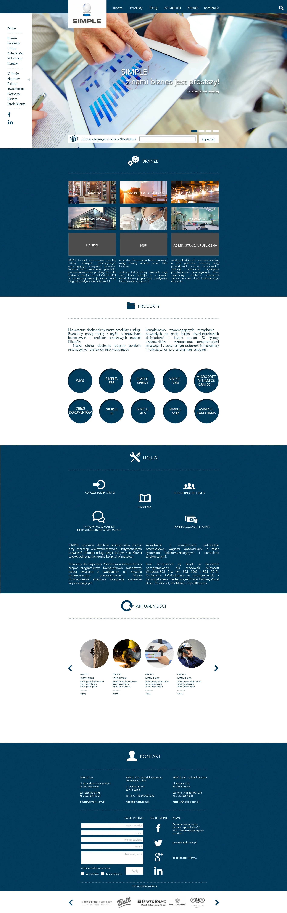
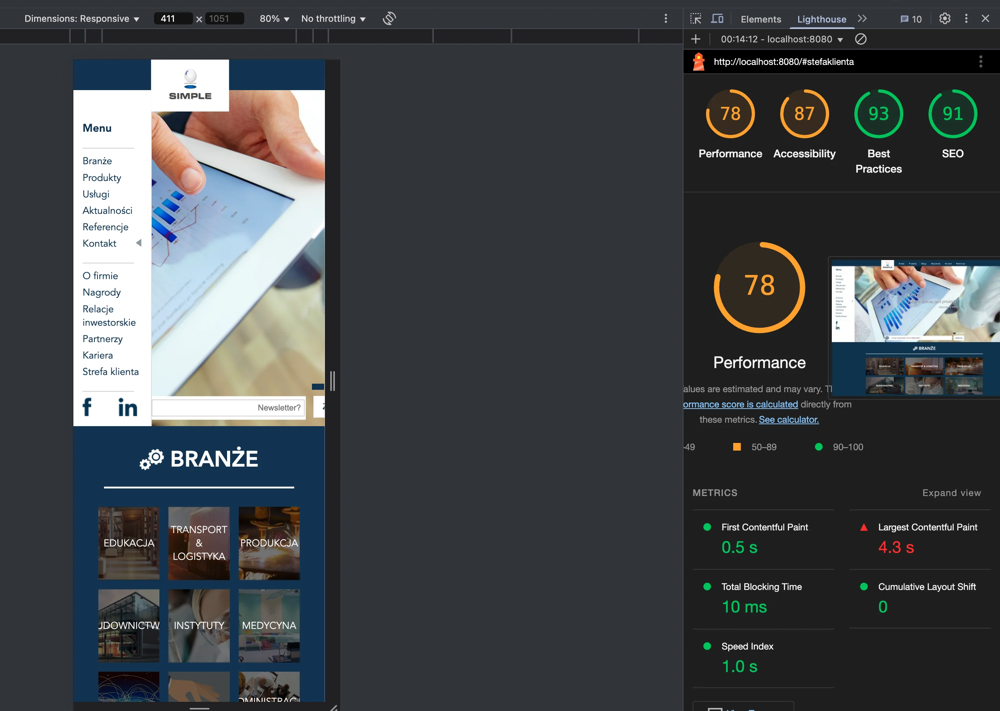
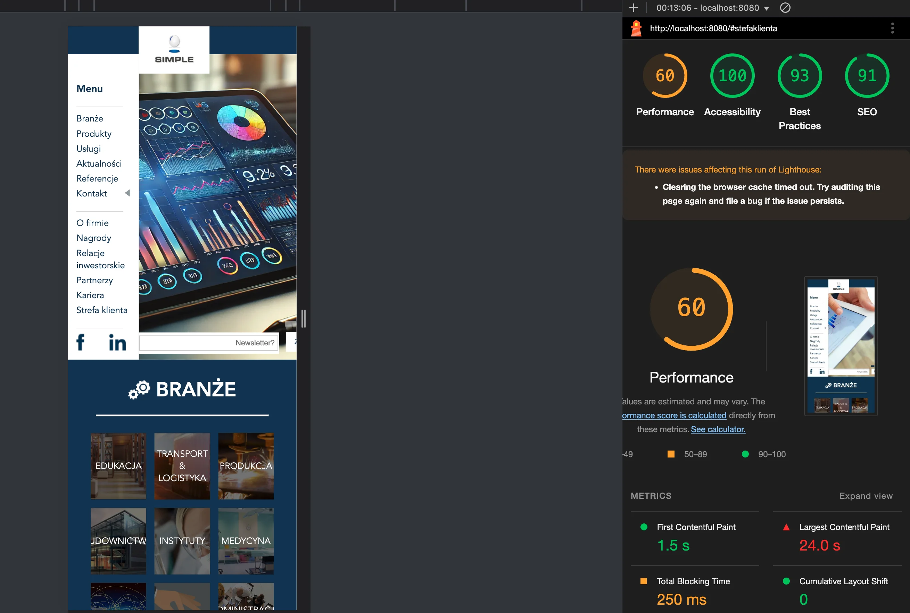

# Layout Simple

> 🧱 **Content lives in files, not in templates** — a Vue 3 business layout where every section reads its own data module

**Layout Simple** is a corporate landing page rebuilt out of nine independent sections: navbar, slider, services, industries, products, news, client logos, sidebar and footer. Each one is a component with two companions — a data module under `src/data` and a stylesheet under `src/styles` — so changing the wording or the pricing never means opening a template.

That split is the whole point of the project: the markup is the shape, the data file is the content, and swapping the content does not risk the layout.


---

## 🎯 Key Features

- **Content as data modules** — `AktualnosciScript.js`, `ProduktyScript.js`, `UslugiScript.js` and the rest export plain arrays. Editing the offer is editing a list, and a typo cannot break the markup.
- **One stylesheet per section** — `src/styles` mirrors `src/components`, so a section's styles are findable by name and cannot leak into a neighbour by accident.
- **Nine sections that stand alone** — each component renders from its own data and can be removed from the page without touching the others.
- **A slider, a logo wall and a news strip** — the parts a business site actually needs, built in rather than pulled from a carousel library.
- **A sidebar that folds on mobile** — navigation collapses rather than shrinking to unusable width.
- **Measured** — Lighthouse reports for desktop and mobile are in `docs/lighthouse`.

---

## 🖼️ Preview

[](tasks/simple.webp)

| Lighthouse, desktop                              | Lighthouse, mobile                              |
| ------------------------------------------------ | ----------------------------------------------- |
|  |  |

---

## 🧩 Section Map

| Component              | Data module              | Purpose                                |
| ---------------------- | ------------------------ | -------------------------------------- |
| `MainNavbar.vue`       | `NavbarScript.js`        | Navigation and the top bar.            |
| `MainSlider.vue`       | `SliderScript.js`        | Opening carousel.                      |
| `MainUslugi.vue`       | `UslugiScript.js`        | Services.                              |
| `MainBranze.vue`       | `BranzeScript.js`        | Industries served.                     |
| `MainProdukty.vue`     | `ProduktyScript.js`      | Product listing.                       |
| `MainAktualnosci.vue`  | `AktualnosciScript.js`   | News strip.                            |
| `MainLogaFirm.vue`     | `LogaFirmScript.js`      | Client logo wall.                      |
| `MainSidebar.vue`      | `SidebarScript.js`       | Side navigation.                       |
| `MainFooter.vue`       | `FooterScript.js`        | Footer columns and contact details.    |

---

## 🛠️ Technology Stack

| Technology     | Version | Role                                            |
| -------------- | ------- | ----------------------------------------------- |
| **Vue.js**     | 3.2     | Single-file components.                         |
| **Vue CLI**    | 5       | Dev server, build and linting.                  |
| **core-js**    | 3.8     | Polyfills for the browser target.               |
| **CSS**        | —       | One stylesheet per section, no framework.       |

---

## 🚀 Getting Started

### Prerequisites

- Node.js 16 or newer
- npm

### 1. Clone the repository

```bash
git clone https://github.com/dawidolko/Layout-Simple-Vue.git
cd Layout-Simple-Vue/frontend
```

### 2. Install dependencies

```bash
npm install
```

### 3. Run

```bash
npm run serve   # development server at http://localhost:8080
npm run build   # production build into dist/
npm run lint    # ESLint over the project
```

---

## 📁 Project Structure

```
Layout-Simple-Vue/
├── frontend/
│   └── src/
│       ├── App.vue           # composes the nine sections
│       ├── main.js
│       ├── components/       # MainNavbar, MainSlider, MainUslugi…
│       ├── data/             # one script per section — the content
│       ├── styles/           # one stylesheet per section
│       ├── views/
│       └── assets/
├── docs/                     # documentation and Lighthouse reports
└── tasks/                    # design brief and reference screenshots
```

---

## 📄 License

MIT © [Dawid Olko](https://dawidolko.pl)
